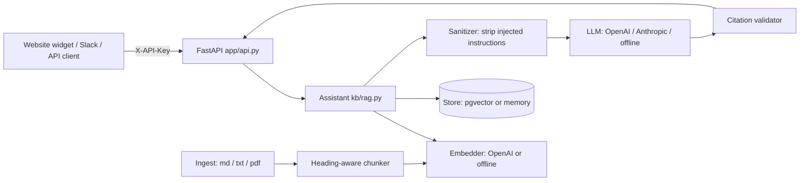

# Knowledge Base Assistant (RAG): demo project

> **Demo project, not client work.** "Northwind Desk" is a fictional company and every fact in `sample_data/` is invented.

An AI assistant that answers questions **only from a company's own documents**. It cites its sources, refuses when the documents don't contain the answer, and strips prompt-injection text from sources before any model sees them. It is built as production software: multi-tenant API, tests, an evaluation gate in CI, structured logs and cost tracking.

## Why it exists

Support and internal teams lose hours answering questions that are already documented. Generic chatbots make things up. This assistant is designed so a business can trust its answers:

| Risk | What this project does |
| --- | --- |
| Made-up answers | Answers only from retrieved sources; refuses below a retrieval-score threshold; flags answers whose citations don't match a real source (`grounded=false`) |
| Can't verify answers | Every answer carries numbered citations (file and section) |
| Prompt injection hidden in documents | Instruction-like sentences are stripped from sources and counted (`injection_flags`); the system prompt also tells the model to treat sources as data |
| One customer seeing another's data | Every store query is scoped by `org_id`; API keys map to tenants |
| Quality silently degrading | 26-case evaluation set runs in CI and fails the build below 80% |
| Surprise AI bills | Token usage and estimated cost logged per request |

## Architecture



**Retrieval is hybrid:** vector similarity (65%) blended with keyword relevance (35%). This catches exact terms like "HMAC-SHA256" or plan names that embeddings alone can miss.

## Quick start (offline: no API keys, no database)

Offline mode uses deterministic hashing embeddings and an extractive answerer. The answerer quotes the best-matching source sentences, so the whole pipeline (retrieval, citations, refusals, injection filtering, evals) can be demonstrated and tested for free. For fluent answers, switch to a real model (next section).

```bash
pip install numpy pypdf pytest
python -m kb.cli ingest sample_data/northwind
python -m kb.cli ask "How long do I have to request a refund?"
python -m kb.cli ask "What is the weather in Karachi?"        # refuses
python -m kb.cli eval evals/questions.jsonl
pytest -q
```

## With real models and the web demo

```bash
pip install -r requirements.txt
cp .env.example .env      # set KB_LLM_PROVIDER=openai (or anthropic) and the API key
uvicorn app.api:app --reload
# open http://localhost:8000 for the chat page, or http://localhost:8000/docs for the API
```

Production-style setup with PostgreSQL + pgvector:

```bash
# in .env: KB_STORE=pgvector, KB_EMBEDDING_PROVIDER=openai, OPENAI_API_KEY=...
docker compose up --build
```

### API

```bash
curl -X POST localhost:8000/v1/ask -H "X-API-Key: change-me" -H "Content-Type: application/json" \
     -d '{"question":"Which plans include the Shopify integration?"}'

curl -X POST localhost:8000/v1/documents -H "X-API-Key: change-me" -F "files=@handbook.pdf"
curl -X DELETE localhost:8000/v1/documents/handbook.pdf -H "X-API-Key: change-me"
```

Response fields: `answer`, `citations[]` (source, section, snippet, score), `refused`, `grounded`, `top_score`, `injection_flags`, `latency_ms`, `cost_usd`, `model`.

## Evaluation

`evals/questions.jsonl` has 26 labeled cases: 21 answerable questions, 4 out-of-scope questions that must be refused, and 1 prompt-injection case.

Current result in offline mode:

| Metric | Result |
| --- | --- |
| Pass rate | 26 / 26 |
| Retrieval hit rate (expected source retrieved) | 100% |
| Citation accuracy (expected source cited) | 100% |
| Answer contains the key fact | 100% |
| Refusal accuracy | 100% |
| Grounded answers | 100% |

**Read this honestly:** the questions were written alongside the system on a small, clean 6-document corpus, so these numbers show the pipeline works end to end. They don't predict accuracy on a real client's documents. For client work, build the eval set from 30–50 of the client's real questions **before** tuning, and report results with the real model in use.

## Project layout

```
kb/            core library (no web framework dependency)
  chunking.py    heading-aware chunks with overlap
  embeddings.py  OpenAI or offline hashing embeddings
  store.py       MemoryStore and PgVectorStore, hybrid search, tenant scoping
  llm.py         OpenAI, Anthropic, offline extractive; system prompt
  rag.py         Assistant: ingest, retrieve, sanitize, answer, validate citations
  evals.py       evaluation harness
  cli.py         command-line demo
app/api.py     FastAPI service (auth, rate limit, uploads, JSON logs) + chat.html
db/schema.sql  pgvector schema: chunks (HNSW + full-text), api_keys, runs
evals/         labeled question set
tests/         pytest suite (11 tests)
```

## Verification status

| Part | Status |
| --- | --- |
| Core pipeline, evals, CLI | Re-run 6 Nov 2026: 11 pytest tests pass. Offline eval 26/26 (retrieval, citations, key facts, refusals, grounded all 100%). Median latency 3 ms, cost $0 |
| API and chat page | Run with `uvicorn app.api:app` on 127.0.0.1:8000. The chat page answered the refund question with citations and refused "What is the weather in Karachi?" |
| Demo video | `demo-assets/northwind-kb-demo-2min.mp4` (1:51), recorded from the live chat page |
| PgVectorStore and `db/schema.sql` | Written but **not yet run against PostgreSQL + pgvector**. Run `docker compose up` once to confirm |
| OpenAI / Anthropic providers | Written against the official SDKs. **Not called on this run:** no `OPENAI_API_KEY` was available. Re-run `KB_LLM_PROVIDER=openai KB_EMBEDDING_PROVIDER=openai python -m kb.cli eval evals/questions.jsonl` after a fresh ingest and record those numbers |

## Next steps (roadmap)

- Feedback endpoint (thumbs up/down) writing to the `runs` table
- Reranking step (cross-encoder or LLM rerank) for large corpora
- Langfuse tracing; scheduled re-indexing from Google Drive / Notion / Zendesk
- Streaming responses in the chat page

## Portfolio description (for Upwork)

> **Demo project: AI knowledge base assistant (RAG).** An assistant that answers questions from a company's own documents with citations, and refuses instead of guessing when the answer isn't there. Python core with hybrid vector + keyword retrieval (pgvector), OpenAI/Anthropic support, a prompt-injection filter, a multi-tenant FastAPI service and an evaluation set that runs in CI. On the 26-case offline eval: 100% retrieval hit rate and 100% correct refusals. Repo: https://github.com/MujtabaJ/kb-assistant. Chat video: https://github.com/MujtabaJ/kb-assistant/blob/main/demo-assets/northwind-kb-demo-2min.mp4. *(OpenAI eval numbers still to be added.)*
